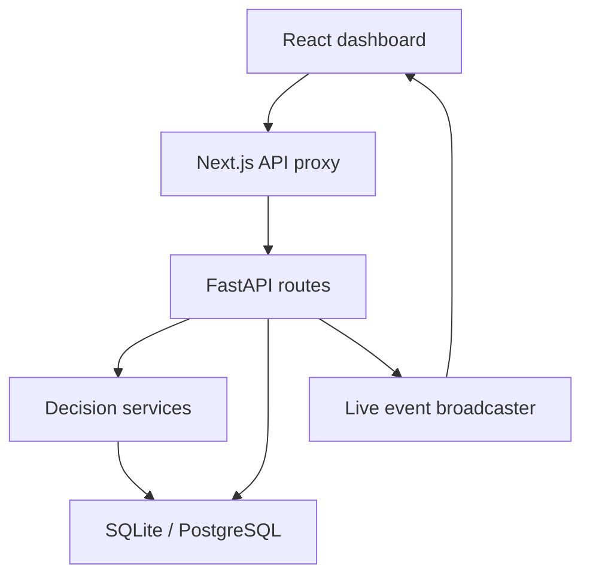

# Lok Sahayak — Four-person presentation guide

Keep the complete project together. The four parts below divide presentation ownership, not the executable folder: the frontend, API, database, and services depend on each other.

Suggested timing: 3 minutes per person + 3 minutes of demonstration = about 15 minutes. Each person should understand the overall request flow and then explain their own module in detail.

## Shared opening

“Lok Sahayak helps hospital staff track medicine stock, identify batches nearing expiry, estimate future demand, plan purchases, and coordinate available hospital beds. We use a dashboard connected to a backend and a database, so actions change saved records rather than only changing what appears on the screen.”

Example connecting every part: A staff member sees low stock, checks the demand forecast, approves a purchase recommendation, and records its delivery. The backend stores the order and receipt; the database stock changes; the dashboard refreshes through live events.

## Part 1 — Problem, architecture, and frontend

**Owner:** Person 1. **Files:** `frontend/src/app/page.tsx`, `layout.tsx`, `globals.css`, `components/Sidebar.tsx`, `TopHeader.tsx`, `CommandCenterView.tsx`, and `frontend/src/lib/api.ts`.

### What to explain

Hospitals need reliable answers to three practical questions: Which medicines need attention? Which batches should be used first? Where are beds available? The application organizes these into five pages: overview, inventory, forecasting, beds/dispatch, and purchasing.

The frontend uses Next.js, React, TypeScript, Tailwind CSS, Lucide icons, and Recharts. React state stores the active page, work view, selected medicine, filters, and loaded records. A component is one reusable section of the interface—for example, the header or hospital finder.

The work-view selector restricts the selected work area: Inventory Manager sees only inventory, Procurement Officer sees only purchasing, and Administrator sees every page. Navigation, actions, data fetching, and API calls respect that selection. The role persists after refresh. The demo still allows manual role switching; secure user identity requires authenticated login. Search filters real loaded records and includes batch-number matching.

### Architecture

- The **frontend** displays data and captures clicks and form values.
- The **API** is the agreed interface between the browser and the backend.
- The **backend** validates actions and applies business rules.
- The **database** retains the records after refresh or restart.
- The **live stream** tells connected dashboards that saved information changed.

`api.ts` maps the backend's field names into frontend types. For example, `item_code` becomes `sku`, `remaining_quantity` becomes `current_quantity`, and forecast history is combined with future points into the chart series. This mapping prevents empty cells, undefined values, and broken charts.

### Demo and speaking script

Show the overview, select Inventory Manager, search for a medicine, clear search, then switch to Hospital Administrator to open forecasting.

“Our interface keeps the same visual design while making the actions clearer. Each page is a React component. When we load a page, the frontend calls the API and displays the returned data. The search operates on real medicine, batch, and hospital records. The work view restricts the available screens and actions for each staff role. Errors are visible rather than silently replaced with fictional data.”

**Handoff:** “Person 2 will explain how those records are stored and how stock updates remain consistent.”

## Part 2 — Backend, database, inventory, and expiry

**Owner:** Person 2. **Files:** `backend/main.py`, `app/database.py`, `app/models/inventory.py`, `models/transactions.py`, `routes/inventory_routes.py`, `schemas/inventory_schemas.py`, `services/risk_expiry.py`, and `frontend/src/components/InventoryMatrix.tsx`, `FEFOModal.tsx`.

### What to explain

FastAPI creates HTTP endpoints. SQLAlchemy maps Python model classes to database tables. SQLite is the local default; Docker uses PostgreSQL. At first startup, the app creates tables and seeds sample records. Later startups retain the data.

| Record | Purpose |
|---|---|
| Item | Medicine identity, category, current stock, cost, safety threshold, temperature |
| Batch | Quantity, batch number, supplier, manufacture date, expiry date |
| Stock transaction | Records how and why stock changed |
| Daily consumption | Usage history for demand prediction |
| Hospital and bed allocation | Facility details and capacity by bed type |
| Purchase order | Approved quantity, supplier, cost, status |
| Patient dispatch | Destination, bed type, patient count, status |
| Preparedness alert | Health advisory and recommended action |
| Application state | Saved emergency-reserve settings |

An item can have many batches. Dispensing must reduce both the selected batch quantities and the item's total stock, and record transactions. This is why the batch layer matters: a total of 50 units alone does not tell us whether those units are expired.

### First Expiring, First Out

This policy uses the eligible batch with the earliest expiry date first. Expired batches and empty batches are excluded.

Example: Batch A has 8 units expiring in 20 days; Batch B has 15 expiring in 90 days. A request for 10 units takes 8 from A and 2 from B. Both batches and total item stock are updated together.

The preview does not change stock. Confirmation recalculates the plan and commits it in one database transaction. If the complete quantity is unavailable or a batch changes during the operation, the request fails without committing a partial dispense. Quantity must be positive, and expired batches cannot be dispensed.

### Risk and temperature

The risk score combines shortage, expiry, and delivery risk. Ordinary items use 45% shortage, 35% expiry, and 20% supplier risk. Trauma-critical items use 50%, 30%, and 20%. The configured storage value is shown with a clear “Store at … °C” badge; this is a storage instruction, not a temperature-sensor reading.

### Demo and speaking script

Expand one medicine, show batch expiry dates, preview a small dispensing quantity, and confirm.

“We keep medicine totals and individual batches in separate tables. First Expiring, First Out chooses unexpired batches by earliest expiry. The preview helps staff review the selection; confirmation saves the full stock change in one transaction. We validate quantities and availability before changing records. The stock transaction table gives us an audit trail, while daily usage contributes to forecasting.”

**Handoff:** “Person 3 will explain how historical usage becomes forecasts and purchase recommendations.”

## Part 3 — Forecasting, purchasing, and public-health intelligence

**Owner:** Person 3. **Files:** `services/ml_forecasting.py`, `reorder_optimizer.py`, `anomaly_detection.py`, `public_health_nlp.py`, `routes/forecast_routes.py`, `optimization_routes.py`, `nlp_routes.py`, and frontend `ForecastingView.tsx`, `ProcurementView.tsx`, `PublicHealthModal.tsx`.

### Demand forecasting

The main forecasting model is **Ridge regression**, using a time trend, day-of-week features, previous-day usage, and usage seven days earlier. Ridge adds a penalty to avoid excessively large model coefficients. A short history uses a simple average-based estimate instead.

The history is divided chronologically into training data and a later held-out portion. Mean Absolute Error reports the average size of prediction errors. Root Mean Squared Error puts greater weight on large errors. R squared compares fit with a mean-based baseline; it is not “percentage accuracy.”

Forecast period controls how many future daily values are requested: a 14-day choice returns 14 future dates, while 60 days returns 60. The shaded band represents model uncertainty; the 95% band is wider than the 80% band. These are approximate model intervals, not a guarantee.

Estimated stock depletion accumulates future predicted demand until it reaches current stock. A longer period does not mean every day's demand must change.

### Purchasing and Economic Order Quantity

The reorder level combines demand during supplier delivery time and a safety buffer adjusted for supplier reliability and trauma importance. In emergency mode, the planning buffer for trauma items increases.

**Economic Order Quantity** balances how often orders are placed against the cost of storing large quantities:

\[
Q = \sqrt{\frac{2DK}{hC}}
\]

Here, D is annual demand, K is cost per order, h is the annual holding-cost rate, and C is unit cost. The recommendation also respects minimum quantities, stock deficits, and eligible bulk discounts.

Supplier ranking weighs reliability, on-time delivery, lead time, and price. In this dataset each supplier has sample cost matrices; there is no live supplier connection.

Example lifecycle: Recommend 100 units → Approve order → saved approved order, stock unchanged → Record delivery → new batch and stock +100. Cancelling an approved order reopens the possibility of a recommendation. Repeated approvals or receipts are blocked.

### Health bulletins and unusual usage

A health bulletin is entered manually. Rule-based keyword matching detects diseases and affected medicine names. The backend compares those medicines with planning thresholds and saves a preparedness alert when items match. Hashed 128-dimensional vectors support similarity scoring; optional Milvus storage is available. Do not claim that this is a trained language model or an automatic official surveillance integration.

Unusual consumption is checked statistically using recent usage, including z-score and interquartile-range logic. This indicates a need to review, not a medical diagnosis or proof of leakage.

### Demo and speaking script

Change forecast period from 30 to 14 days; switch the interval; approve one purchase recommendation; show its saved status; add an example health bulletin.

“We use historical daily usage to predict future demand. The model considers weekly patterns and previous consumption, and we evaluate it on later data. Purchasing combines these planning needs with delivery time and supplier performance. Approval saves an order and its expected arrival date. Inventory shows the incoming quantity and remaining delivery days; only recording delivery changes physical stock. Public-health bulletins can raise preparedness alerts when a disease signal matches relevant medicines.”

**Handoff:** “Person 4 will demonstrate emergency beds, patient dispatch, and how updates reach the dashboard.”

## Part 4 — Emergency beds, dispatch, live updates, assistant, and validation

**Owner:** Person 4. **Files:** `models/hospital.py`, `routes/emergency_routes.py`, `services/spatial_emergency.py`, `sse_websocket.py`, `antigravity_agent.py`, `routes/assistant_routes.py`, `stream_routes.py`, and frontend `EmergencyHospitalFinder.tsx`, `AlertFeed.tsx`, `AIAssistantDrawer.tsx`, plus `tests/`.

### Bed management and dispatch

Each hospital has bed categories with total capacity, available beds, and occupied beds. Saving available beds recalculates occupied beds and rejects impossible values. Active dispatch reservations must remain included in the occupied count.

Dispatch reserves a selected bed type for the patient count. Rejecting dispatch releases the reservation. Reassigning moves it to another hospital only if that hospital can accept the entire count; the release and new reservation are one transaction. Completing ends the reservation after it is no longer needed; this application does not manage patient treatment or actual ambulance messages.

Example: Hospital A has 5 trauma beds free; Hospital B has 3. Dispatch 2 patients to A → A has 3 free. Change hospital to B → A returns to 5 and B has 1. Reject dispatch → B returns to 3. Reassigning to a full hospital fails without losing the original reservation.

Distance ranking uses the Haversine formula, which calculates great-circle distance from coordinates. Travel time is estimated using a simple average speed. The radar is an illustrative network view, not an actual road map.

### Emergency stock reserve

Turning it on applies a 2.5× planning reserve to trauma-critical supplies and recalculates procurement/readiness deficits. It does not increase physical inventory. The state is saved and restored at startup.

### Live updates and assistant

Server-Sent Events allow the backend to push an event when an action is saved. The frontend receives the event, displays recent activity, and reloads affected data. The connection badge follows actual open/error events; reconnect is handled by the browser. Turning off auto-scroll leaves incoming updates active.

The assistant classifies a question by keywords, queries current database records, and returns a template-based explanation with record citations. It is grounded in saved facts and does not fabricate an answer when the API is unavailable. Suggested questions trigger another query; they are not automated real-world actions.

### Validation and speaking script

Manage bed availability, dispatch 2 patients, change hospital, reject dispatch, then open the activity feed and ask the assistant about low stock.

“Our dispatch workflow changes saved bed availability. Capacity checks prevent overbooking, and hospital reassignment moves the reservation atomically. The backend broadcasts saved actions through Server-Sent Events so connected dashboards can refresh. We tested backend workflows, frontend builds, and browser interactions. The assistant uses live database facts and citations, but it remains a rule-based helper.”

End with: “The system demonstrates an integrated hospital operations workflow. A future deployment would add login permissions, verified clinical data, real supplier and ambulance integrations, and a shared event broker.”

## Questions the team should be ready to answer

| Question | Answer |
|---|---|
| Does approval immediately increase stock? | No. Approval creates an order; recording its delivery increases stock. |
| What happens when a hospital lacks beds? | Dispatch/reassignment is rejected and existing reservations are preserved. |
| Why does the forecast period not drastically change daily values? | It sets the number of dates; forecasts for overlapping dates may remain similar. |
| Is R squared the accuracy percentage? | No. It measures fit relative to a mean-based baseline. |
| Is temperature measured live? | No. It is the configured storage instruction. |
| Do all medicine batches count as usable stock? | Expired batches are tracked but excluded from dispensing. |
| Is this connected to official disease feeds? | No. Bulletins are manually entered; presets are examples. |
| Is the assistant powered by an external language model? | No. It routes questions through rules and uses saved database facts. |
| Does changing the work view change permissions? | Yes, screens, actions, and API requests are restricted to the selected role. Manual role switching is still available for the demo; there is no authenticated identity. |
| Does the radar show real roads? | No. It illustrates the hospital network; distance is coordinate-based. |
| What is persisted? | Inventory, transactions, orders, hospitals, beds, dispatch, alerts, and emergency state. Process-local live notifications and fallback vectors are transient. |
| Why use a database transaction? | It commits related changes together, or rolls them back on failure. |

## Safe demo sequence

Start with a fresh sample database and both services running. Avoid deleting an existing database containing data you want to retain. Use a small dispensing quantity, approve only one order, and dispatch only one or two patients. End by turning emergency reserve off and rejecting/completing the test dispatch. Read `VALIDATION.md` for the exact tested scope and remaining deployment limitations.
