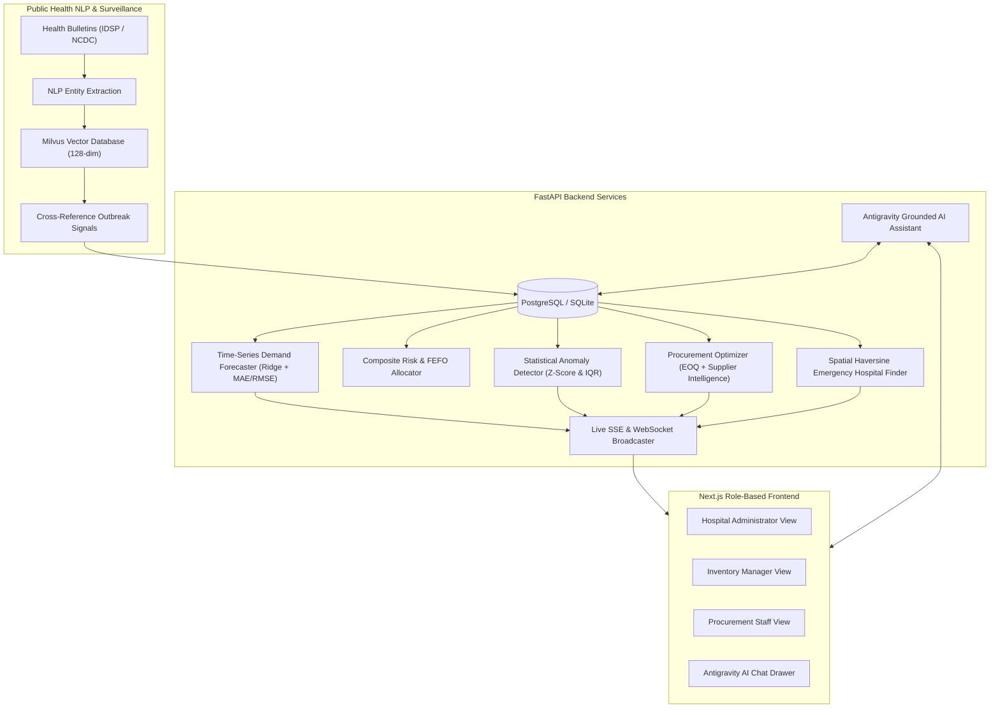

# Lok Sahayak: Smart Health Centre Management for Hospital Inventory
### AI-Enabled Proactive Decision-Support System powered by Antigravity Infrastructure

---

## 🌟 Executive Overview

**Lok Sahayak** transitions hospital inventory and supply chain operations from **reactive manual tracking** to **proactive, data-driven forecasting**. Built with **Antigravity** as its core decision-support infrastructure, the platform integrates statistical machine learning, real-time spatial analytics, and Milvus vector intelligence to prevent stockouts, eliminate batch expiry waste, optimize procurement costs, and manage mass-casualty surges.

---

## 🏛️ System Architecture



---

## 🚀 Key Modules & Capabilities

### 1. Database & Relational Data Models (Phases 1 & 2)
* **Inventory & Consumables**: SKU Code, Category, Unit, Current Stock, Safety Threshold, Unit Cost, Cold Chain Temp, Trauma Criticality flag.
* **Batch & Expiry**: Batch Numbers, Manufacturing & Expiry Timestamps, Remaining Quantities, Purchase Price, Supplier IDs.
* **Hospitals & Beds**: GPS Coordinates (`latitude`, `longitude`), Trauma Level (Level-1, Level-2, District), Bed Allocation Breakdown (`Trauma`, `ICU`, `General`, `Pediatric`, `Oxygen`).
* **Suppliers & Cost Matrices**: Historical Lead Times, Reliability Scores ($0.0 - 1.0$), On-Time Delivery Rates, Quality Compliance, Bulk Volume Discount breaks.
* **Transactions & Consumption Logs**: Continuous stock movements (`CONSUMPTION`, `RECEIPT`, `DISPATCH`), departmental usage attribution.

### 2. Time-Series ML Demand Forecasting (Phases 3 & 4)
* **Model**: Multi-feature Autoregressive Ridge Regression with day-of-week seasonality decomposition and lag features ($Lag_1, Lag_7$).
* **Model Metrics**: Out-of-sample **Mean Absolute Error (MAE)**, **Root Mean Squared Error (RMSE)**, and $R^2$ fit scores.
* **Stock-Out Projection**: Estimates time-to-depletion and exact calendar stockout dates based on forward consumption integrals.

### 3. Stock-Out, Expiry Risk & FEFO Allocation Engine
* **Composite Inventory Risk Score ($0 - 100$)**:
  $$\text{Composite Risk} = 0.45 \cdot \text{StockOutRisk} + 0.35 \cdot \text{ExpiryRisk} + 0.20 \cdot \text{SupplierLeadTimeRisk}$$
* **FEFO Protocol (First-Expired, First-Out)**: Automatically routes dispensations to batches with earliest expiry dates first to prevent medication expiration write-offs.

### 4. Statistical Anomaly Detection
* **Z-Score Spike Detection**: $Z = \frac{x_t - \mu_{window}}{\sigma_{window}}$ (threshold $\pm 2.3$).
* **IQR Outlier Bounds**: Flags sudden spikes (mass emergencies or epidemic surges) and drops (unrecorded consumption shifts).

### 5. Procurement Optimization Engine (Phase 5)
* **Supplier Intelligence**: Multi-attribute ranking evaluating reliability, on-time delivery rate, lead time, and cost matrices.
* **Dynamic Reorder Point (ROP)**:
  $$\text{ROP} = (\text{Daily Demand} \times \text{Lead Time}) + \text{Safety Buffer} \times (1 + (1 - \text{Reliability}))$$
* **Economic Order Quantity (EOQ)**:
  $$\text{EOQ} = \sqrt{\frac{2 \cdot D_{\text{annual}} \cdot K}{h \cdot C}}$$

### 6. Emergency & Spatial Intelligence (Phase 6)
* **Haversine Proximity Ranking**: Great-circle distance calculations ranking hospitals by transit time and real-time bed capacity.
* **Emergency Surge Mode**: Dynamically elevates trauma safety stock buffers by **2.5x** and flags surge deficits.

### 7. Public Health NLP Pipeline with Milvus (Phases 7 & 8)
* Semantic entity extraction for disease types (Dengue, Influenza, Cholera, Trauma).
* 128-dimensional dense vector embeddings indexed into **Milvus Vector Database**.
* Auto-generates **AI Preparedness Alerts** with mathematical reasoning when regional outbreaks threaten internal inventory runways.

### 8. Role-Based Next.js Dashboard & Antigravity Assistant (Phase 9)
* **Hospital Administrator**: Regional bed occupancy matrix, network risk index, epidemic alerts.
* **Inventory Manager**: Real-time stock levels, FEFO batch expiry tracker, usage recording.
* **Procurement Staff**: Automated purchase order recommendations, supplier performance scorecards.
* **Antigravity AI Assistant**: Conversational agent providing grounded natural language answers with auditable live citations.
* **Explainability Guarantee**: Every alert displays data provenance, timestamp, and mathematical formula.

---

## 🛠️ Tech Stack

| Layer | Technology |
|---|---|
| **Core Infrastructure** | Antigravity AI Decision Framework |
| **Backend API** | Python 3.11+, FastAPI, Uvicorn |
| **Database** | PostgreSQL / SQLite (async with SQLAlchemy 2.0 & Greenlet) |
| **Vector Database** | Milvus / Milvus Lite (128-dim Cosine Similarity) |
| **ML & Forecasting** | Scikit-Learn, NumPy, Pandas, SciPy |
| **Real-time Bus** | Server-Sent Events (SSE) & WebSockets |
| **Frontend Client** | Next.js 15, React 19, TypeScript, Lucide Icons |
| **Styling** | Vanilla CSS Glassmorphism Design Tokens |

---

## 💻 Running the Complete Stack Locally

### Option A: Zero-Setup Local Development (SQLite + Milvus Lite)

#### 1. Start the FastAPI Backend
```bash
# From workspace root
python3 -m backend.main
```
The server will start at `http://localhost:8000`. On first run, it automatically seeds:
- 12 pharmaceutical & trauma critical consumables
- 30+ batches with realistic expiry profiles
- 5 regional network hospitals with real-time bed capacity
- 4 qualified medical suppliers with scorecards
- 60 days of historical consumption logs

#### 2. Start the Next.js Frontend
In a separate terminal:
```bash
cd frontend
npm run dev
```
Open your browser at **`http://localhost:3000`**.

---

### Option B: Production Containerized Stack (PostgreSQL + Milvus Standalone)

Run the entire cluster with Docker Compose:
```bash
docker compose up -d --build
```
This starts:
- `lok_sahayak_postgres` on port `5432`
- `lok_sahayak_milvus` (with etcd & MinIO) on port `19530`
- `lok_sahayak_backend` on port `8000`
- `lok_sahayak_frontend` on port `3000`

---

## 📡 API Endpoints Reference

| Endpoint | Method | Description |
|---|---|---|
| `/api/inventory/items` | `GET` | List items with composite risk scores and days left |
| `/api/inventory/batches` | `GET` | List batches sorted by FEFO (earliest expiry first) |
| `/api/inventory/adjust` | `POST` | Record consumption/receipt with automatic anomaly scan |
| `/api/inventory/fefo-allocate` | `POST` | Simulate FEFO pick-list for requested quantity |
| `/api/forecast/item/{id}` | `GET` | 30-day forecast, MAE, RMSE, and stock-out runway |
| `/api/procurement/reorders` | `GET` | Recommended POs via dynamic EOQ and supplier utility |
| `/api/procurement/suppliers` | `GET` | Supplier scorecards (reliability, SLA, lead time) |
| `/api/emergency/hospital-finder` | `POST` | Haversine spatial ranking of nearby hospitals |
| `/api/emergency/toggle` | `POST` | Toggle 2.5x emergency surge inventory mode |
| `/api/nlp/ingest` | `POST` | Ingest external disease bulletin & index into Milvus |
| `/api/nlp/alerts` | `GET` | Active AI preparedness alerts with mathematical reasoning |
| `/api/assistant/chat` | `POST` | Antigravity AI Assistant query with grounded citations |
| `/api/stream/sse` | `GET` | Server-Sent Events live event stream |
| `/api/stream/ws` | `WebSocket` | Real-time bidirectional WebSocket channel |
