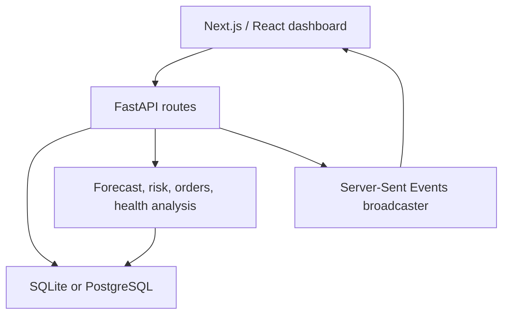

# Lok Sahayak — Hospital Inventory & Bed Management

A Next.js dashboard connected to a FastAPI backend for medicine inventory, batch dispensing, demand forecasts, purchasing, public-health alerts, and patient dispatch.

## Quick start

Prerequisites: Python 3.11 or 3.12, Node.js 20 or newer, and npm. Run all backend commands from this project folder, not from `backend/`.

1. Install backend dependencies in a virtual environment:

```bash
python3 -m venv .venv
source .venv/bin/activate
python -m pip install -r backend/requirements.txt
```

On Windows, activate with `.venv\Scripts\activate` and use `python` in place of `python3`.

2. Install frontend dependencies:

```bash
cd frontend
npm ci
cd ..
```

3. Start both services:

```bash
python start.py
```

Open **http://localhost:3000**. API documentation: **http://localhost:8000/docs**.
Use Ctrl+C to stop both services. Alternatively run `python -m backend.main` and `npm run dev` (inside `frontend`) in separate terminals.

SQLite is created automatically as `hospital_inventory.db`. The first startup creates the sample hospital network, 12 inventory items, batches, suppliers, and 60 days of consumption history. Subsequent startups retain purchases, stock movements, beds, dispatch records, and emergency reserve settings. No external API key or vector database is needed for the local demo.

## Main workflows

- **Your work view:** Administrator can use all pages; Inventory Manager can use only Medicine Inventory; Procurement Officer can use only Purchasing & Orders. The sidebar, actions, data requests, and API policy follow this selection. The selected role persists after refresh. This is a demo role switcher, not authenticated login; a real deployment must determine roles from verified user accounts.
- **Search:** Find medicine names, item codes, categories, batch numbers, hospital names, and purchase recommendations. Use the result buttons to open a matching page; Clear search restores all data.
- **Medicine inventory:** Expand a row for risk and batch details. Storage badges show the configured value in degrees Celsius. Preview dispensing selects unexpired batches by earliest expiry. Confirm dispensing commits the complete request atomically, updates stock and daily consumption, and checks unusual usage.
- **Purchasing:** Approve a recommendation to save an order. It moves to order history and is removed from pending recommendations. Approval does not add physical stock. Inventory and order history show the saved estimated delivery date, remaining days, incoming quantity, and overdue status based on supplier lead time. The ETA is a planning estimate and does not auto-receive stock. Record delivery adds a new batch; Cancel order allows a new recommendation. Repeat delivery/approval actions are blocked. The demonstration delivery action uses a clearly documented 365-day sample shelf life; real deployments should capture supplier batch and expiry metadata.
- **Forecasting:** Changing the forecast period requests that many daily predictions; switching the interval changes the uncertainty band. A period controls the number of future dates, not an arbitrary increase in predicted demand. Average prediction error and model fit come from held-out history.
- **Emergency reserve:** Raises the planning safety buffer for trauma-critical items to 2.5 times its baseline. Purchasing recommendations and emergency readiness are recalculated. It does not invent stock receipts or change past consumption.
- **Health bulletins:** Add text manually or choose an example, then Analyze bulletin. Disease keyword extraction checks affected medicines and saves an alert when items match. This is manual ingestion, not an automatic connection to an official agency.
- **Beds and dispatch:** Manage beds saves availability with capacity validation. Dispatch patients reserves the selected number of beds. Reject dispatch releases them; Change hospital moves the reservation in one transaction if capacity exists. Complete dispatch releases the reservation when it is no longer needed; it is not a clinical discharge system.
- **Alerts & Recent Activity:** Saved health advisories and incoming operational events. Filters show emergencies, unusual usage, and health bulletins. Click an alert for source and recommended action. Auto-scroll can be disabled without stopping incoming data.
- **Connection indicator:** Reports the real event-stream connection. On failure the browser retries automatically; errors remain visible instead of fabricated successful responses.
- **Assistant:** Uses deterministic query routing and current database facts with citations. It does not require a large language model API key.

## Architecture and files



| Folder | Responsibility |
|---|---|
| `frontend/src/app` | Main page, layout, shared styles |
| `frontend/src/components` | Dashboard screens, modals, charts, assistant |
| `frontend/src/lib/api.ts` | Requests, error handling, backend-to-frontend field mapping |
| `backend/main.py` | Application startup, database seeding, route registration |
| `backend/app/models` | Inventory, batches, orders, alerts, hospital beds, dispatch, settings |
| `backend/app/routes` | Validated HTTP endpoints and saved workflow actions |
| `backend/app/services` | Statistical forecasting, earliest-expiry allocation, order sizing, distance ranking, health matching |
| `tests` | Backend regression tests and browser workflow checks |

The browser uses same-origin `/api` requests. Next.js forwards these to `BACKEND_URL` (default `http://localhost:8000`). If hosting the API separately, `NEXT_PUBLIC_API_URL` can override the browser address and must be set before building.

## Verification

```bash
python -m unittest discover -s tests -v
cd frontend
npm run lint
npm run build
```

Optional browser checks (start both services with a fresh sample database first):

```bash
cd frontend
npm install --no-save playwright
npx playwright install chromium
npm run test:e2e
```

Browser tests mutate the sample data; use a disposable database. Tests were run with isolated databases, without including their state in the deliverable. See `VALIDATION.md` and `PRESENTATION_GUIDE.md` for the check results and four-person explanation.

## Docker

```bash
docker compose up --build
```

Compose provides PostgreSQL, the existing optional Milvus stack, backend, and frontend. The frontend now proxies to the backend container using `BACKEND_URL`, so browser requests do not depend on internal container names. The frontend build uses the committed lockfile and includes its proxy configuration. Docker execution requires a local Docker installation; container startup was not exercised in the validation environment.

## Scope of the demonstration

This is a presentation-ready local application, not a deployed clinical system. Sample hospital locations and medicine records are illustrative. Travel time is a distance-based estimate; the radar is an illustration, not a navigation map. Health analysis is keyword-based with hashed vectors; Milvus is optional and falls back to a process-local vector store. Alerts persist in the relational database, while fallback similarity-search vectors do not survive restart. The assistant is a rules-based, database-grounded helper. Authentication, real ambulance communication, supplier integrations, and clinical validation are outside this project. Live updates use a single backend process; multi-worker deployments require a shared event broker.
