# Lok Sahayak: Complete Project Explanation & Teacher Defense Guide

> **Note for Presenters:** This document is designed for students who built or vibe-coded this platform and need to deeply understand **every technical detail, architectural choice, mathematical formula, line of code, and system interaction** before presenting to a teacher or panel.

---

## Executive Summary (The 30-Second Elevator Pitch)
> *"Lok Sahayak is an enterprise-grade Smart Hospital Inventory Management and Clinical Decision-Support System. It addresses critical healthcare challenges: medicine stockouts, medication expiration waste, emergency bed shortages during mass casualties, and outbreak-driven demand surges. Unlike superficial dashboards, Lok Sahayak is a full-stack platform backed by a relational database, asynchronous REST APIs, real-time Server-Sent Events (SSE), Scikit-Learn machine learning forecasting, vector-based disease bulletin NLP, and automated First-Expired First-Out (FEFO) dispensing algorithms."*

---

# SECTION 1: Architecture, Tech Stack & Frontend Engineering

### 1.1 The High-Level Architecture
The system uses a modern decoupled client-server architecture:

```mermaid
flowchart TD
    subgraph Frontend ["Frontend (Next.js 15 + React 19)"]
        UI["Clinical Modern Dashboard UI"]
        State["React State & Role Perspective"]
        APIClient["API Client (api.ts Data Normalization)"]
        SSEListener["EventSource (SSE Stream Listener)"]
    end

    subgraph Backend ["Backend (FastAPI + Asynchronous Python)"]
        Router["FastAPI Route Handlers (/api)"]
        Services["Domain Engines (Forecasting, Risk, EOQ, Spatial)"]
        SSEHub["SSE Event Broadcaster (In-Memory Queue)"]
    end

    subgraph DataLayer ["Data & Storage Layer"]
        ORM["SQLAlchemy 2.0 Async ORM"]
        DB[(SQLite / PostgreSQL: hospital_inventory.db)]
        VectorDB[(Milvus Vector DB / In-Memory Hashed Vectors)]
    end

    UI --> APIClient
    APIClient -->|HTTP REST / JSON| Router
    Router --> Services
    Services --> ORM
    ORM --> DB
    Router --> ORM
    Services --> VectorDB
    Router --> SSEHub
    SSEHub -->|text/event-stream| SSEListener
    SSEListener -->|State Revalidation| UI
```



### 1.2 Tech Stack Breakdown & Why Each Was Chosen
| Layer | Technology | Why We Chose It (Teacher Answer) |
|---|---|---|
| **Frontend Framework** | **Next.js 15 (App Router) + React 19** | Server-side rendering capability, blazing-fast route compilation, strict TypeScript enforcement, and component modularity. |
| **Language** | **TypeScript** | Eliminates runtime `undefined` bugs; provides strict typing for medicine batches, bed numbers, and supplier scorecards. |
| **Styling** | **Tailwind CSS** | Utility-first CSS providing a clean, accessible "Clinical Modern" look (high-contrast status badges, responsive layout, slate/emerald palettes). |
| **Data Visualization** | **Recharts** | Declarative SVG-based charting for time-series demand predictions, confidence intervals, and stock trajectories. |
| **Backend Framework** | **FastAPI (Python 3.10+)** | High performance, native `async/await` non-blocking I/O, automatic Pydantic request validation, and OpenAPI documentation (`/docs`). |
| **Database & ORM** | **SQLAlchemy 2.0 (Async) + SQLite/Postgres** | Enterprise relational modeling with foreign keys, transactional integrity (`commit`/`rollback`), and async database sessions. |
| **Machine Learning** | **Scikit-Learn (Ridge Regression)** | Robust, explainable time-series forecasting with L2 regularization that prevents overfitting on short hospital historical data. |
| **Vector Search** | **Milvus Lite / Semantic Projection** | Fast vector similarity search for disease outbreak bulletin clustering and formulary matching. |
| **Real-Time Streaming** | **Server-Sent Events (SSE)** | Unidirectional, lightweight HTTP streaming over standard port 8000; avoids the heavyweight handshake overhead of WebSockets. |

### 1.3 Frontend Directory Structure & Key Files
* `frontend/src/app/page.tsx`: The primary orchestrator. Maintains global state: active navigation tab, role perspective, selected medicine, global search query, emergency surge toggle, and SSE stream listeners.
* `frontend/src/lib/api.ts`: **The API Normalization Gateway**. It maps backend snake_case fields (e.g., `item_code`, `remaining_quantity`, `safety_stock_threshold`) to frontend camelCase interfaces, handles error fallbacks, and prevents empty screen rendering.
* `frontend/src/components/Sidebar.tsx`: Role navigation bar. Allows switching between **Hospital Administrator**, **Inventory Manager**, and **Procurement Officer**.
* `frontend/src/components/TopHeader.tsx`: Global search bar, real-time live connection status indicator (`🟢 Live Connected`), Outbreak Alert button, and Emergency Surge toggle.
* `frontend/src/components/InventoryMatrix.tsx`: Main inventory catalog table. Shows stock levels, bold cold-storage badges, composite risk scores, and FEFO expansion.
* `frontend/src/components/ForecastingView.tsx`: Interactive Recharts time-series graph with 14d/30d/60d horizon buttons and model accuracy metrics.
* `frontend/src/components/EmergencyHospitalFinder.tsx`: Spatial hospital radar, bed capacity counters, and patient transfer dispatch/rejection queue.
* `frontend/src/components/ProcurementView.tsx`: Dynamic reorder recommendations, Economic Order Quantity cards, supplier utility scores, and 1-click PO approval.

### 1.4 Role Perspectives (Role-Based Views)
The application provides customized workflows depending on who is logged in:
1. **Hospital Administrator**: Focuses on hospital-wide readiness, total ICU/trauma bed occupancy, regional mutual-aid patient dispatches, and public health outbreak alerts.
2. **Inventory Manager**: Focuses on stock levels, near-expiry batch tracking, cold storage requirements (2°C–8°C), and FEFO dispensing.
3. **Procurement Officer**: Focuses on purchase orders, supplier lead times, delivery tracking, volume discounts, and restock approvals.

---

# SECTION 2: Database Schema, Backend API & Inventory/FEFO Engine

### 2.1 Relational Database Architecture
The backend uses **SQLAlchemy 2.0** with strict relational integrity. Key tables in `backend/app/models/`:

1. **`items` (`Item`)**: The core medicine catalog.
   * `id`, `name`, `item_code` (SKU), `category` (Antibiotics, IV Fluids, etc.), `unit_cost`, `current_stock`, `safety_stock_threshold`, `min_order_quantity`, `storage_temperature_str` (e.g. `2°C - 8°C`), `is_trauma_critical` (Boolean).
2. **`batches` (`Batch`)**: Individual production lots tied to an Item.
   * `id`, `item_id` (Foreign Key to `items.id`), `batch_number`, `initial_quantity`, `remaining_quantity`, `manufacture_date`, `expiry_date`.
   * *Why this distinction matters:* An item may have 500 units in stock, but they belong to 4 different batches expiring on different dates. Dispensing must track batches, not just the item aggregate.
3. **`stock_transactions` (`StockTransaction`)**: Immutable audit log of every movement.
   * `id`, `item_id`, `batch_id`, `transaction_type` (`DISPENSE`, `RECEIPT`, `WRITE_OFF`, `EMERGENCY_TRANSFER`), `quantity`, `reference_reason`, `timestamp`.
4. **`daily_consumption` (`DailyConsumptionSummary`)**: Aggregated historical usage used as training data for the ML forecasting model.
5. **`hospitals` & `bed_allocations` (`Hospital`, `BedAllocation`)**: Regional healthcare facilities, GPS coordinates (`latitude`, `longitude`), and bed counts categorized by type (`ICU`, `Trauma`, `General`, `Pediatric`).
6. **`patient_dispatches` (`PatientDispatch`)**: Patient transfers between hospitals tracking status (`PENDING`, `DISPATCHED`, `REJECTED`, `COMPLETED`).
7. **`purchase_orders` (`PurchaseOrder`)**: Generated reorders tracking supplier, quantity, cost, order date, expected delivery date, and approval status.

### 2.2 First-Expired, First-Out (FEFO) Dispensing Algorithm
* **Clinical Purpose:** In hospitals, dispensing medications randomly leads to expired drugs sitting at the back of shelves, causing financial loss and clinical hazards. FEFO ensures the batch expiring soonest is used first.
* **Implementation in Code ([`backend/app/services/risk_expiry.py`](file:///Users/riddhijain/Desktop/Lok_Sahayak/backend/app/services/risk_expiry.py)):**
  1. Filters out batches where `remaining_quantity <= 0` or `expiry_date <= today` (expired batches are quarantined).
  2. Sorts candidate batches ascending by `expiry_date`.
  3. Deducts the required quantity sequentially across batches until fulfilled.
  4. **Database Atomicity:** The deduction is performed inside a database transaction (`db.commit()`). If any batch check fails or total stock is insufficient, the entire operation is rolled back (`db.rollback()`), guaranteeing zero data corruption.
  5. Automatically logs a `StockTransaction(type="DISPENSE")` and updates aggregate `item.current_stock`.

### 2.3 The Composite Clinical Risk Score (0 to 100)
Every medicine is assigned an automated risk score to highlight critical items:
$$\text{Composite Risk Score} = (w_{\text{stockout}} \times R_{\text{stockout}}) + (w_{\text{expiry}} \times R_{\text{expiry}}) + (w_{\text{supplier}} \times R_{\text{supplier}})$$

* **Standard Medicines:** $w_{\text{stockout}} = 0.45$, $w_{\text{expiry}} = 0.35$, $w_{\text{supplier}} = 0.20$
* **Trauma-Critical Medicines:** $w_{\text{stockout}} = 0.50$, $w_{\text{expiry}} = 0.30$, $w_{\text{supplier}} = 0.20$ (Stockout penalty is elevated because running out of adrenaline or blood bags is life-threatening).
* **Stockout Risk Component ($R_{\text{stockout}}$):** Exponential risk based on remaining days of supply ($\frac{\text{Current Stock}}{\text{Daily Run Rate}}$) vs safety buffer.
* **Expiry Risk Component ($R_{\text{expiry}}$):** Weighted sum of batch quantities expiring within 30, 60, and 90 days.
* **Supplier Risk Component ($R_{\text{supplier}}$):** Penalizes suppliers with high lead times ($>14$ days) or low historical reliability scores ($<90\%$).

---

# SECTION 3: Predictive ML, Dynamic Procurement & Public Health NLP

### 3.1 Predictive Demand Forecasting (Time-Series ML)
* **Model:** **Scikit-Learn Ridge Regression** (`sklearn.linear_model.Ridge`) in [`backend/app/services/ml_forecasting.py`](file:///Users/riddhijain/Desktop/Lok_Sahayak/backend/app/services/ml_forecasting.py).
* **Why Ridge Regression instead of a Deep Neural Network (LSTM/Transformer)?**
  * *Teacher Answer:* Hospital clinical inventory data at the facility level often has 30 to 180 days of records. Deep learning models severely overfit and require massive GPU clusters. Ridge Regression adds an $L_2$ regularization penalty ($\alpha \sum w_i^2$) to ordinary least squares, preventing wild coefficient swings while remaining fully explainable, ultra-fast ($<5$ms inference), and resilient to sparse data.
* **Feature Engineering:**
  * **Trend Index:** Continuous integer day index ($t = 0, 1, 2, \dots$) capturing baseline consumption drift.
  * **Seasonality:** Day-of-week one-hot/cyclic indicators capturing weekly hospital clinical cycles (e.g. elective surgeries peaking on Tuesdays/Thursdays, emergency admissions rising on weekends).
  * **Autoregressive Lag Features:** Prior consumption at $t-1$, $t-7$ (same day last week), and $t-14$.
* **Model Validation Metrics:**
  * **Mean Absolute Error (MAE):** $\frac{1}{n} \sum |y_i - \hat{y}_i|$ (average deviation in units).
  * **Root Mean Squared Error (RMSE):** $\sqrt{\frac{1}{n} \sum (y_i - \hat{y}_i)^2}$ (penalizes rare, massive errors).
  * **$R^2$ Score:** Measures the proportion of variance explained relative to a simple mean baseline.
* **Dynamic Confidence Intervals:** Projected upper and lower bounds computed as $\hat{y}_t \pm 1.96 \cdot \sigma_{\text{residual}}$ (representing a 95% statistical confidence envelope).
* **Stockout Horizon Calculation:** Accumulates predicted daily demand $\sum \hat{y}_t$ until it exceeds `current_stock`, yielding the exact projected stockout date.

### 3.2 Dynamic Economic Order Quantity (EOQ) & Supplier Intelligence
* **Economic Order Quantity (EOQ):**
  $$\text{EOQ} = \sqrt{\frac{2 \cdot D \cdot K}{h \cdot C}}$$
  * $D$ = Annual Demand (projected daily run-rate $\times 365$)
  * $K$ = Administrative order cost per purchase (set to \$45/order)
  * $h$ = Annual holding cost rate (set to 22% of unit cost)
  * $C$ = Item unit acquisition cost
  * *Purpose:* Balances the cost of ordering frequently against the cost of tying up capital in warehouse storage.
* **Multi-Criteria Supplier Selection Utility Formula:**
  $$\text{Utility Score} = 0.40 \cdot \text{Reliability} + 0.30 \cdot \text{OnTimeRate} + 0.20 \cdot \text{LeadTimeNorm} + 0.10 \cdot \text{PriceCompetitiveness}$$
  * When a reorder point is triggered, the system automatically selects the vendor with the highest composite utility, not just the cheapest one, preventing delayed shipments of life-saving medicines.

### 3.3 Public Health NLP & Vector Embeddings
* **Code:** [`backend/app/services/public_health_nlp.py`](file:///Users/riddhijain/Desktop/Lok_Sahayak/backend/app/services/public_health_nlp.py).
* **How it works:**
  1. Ingests raw public health bulletins (e.g., *"Sudden spike in Dengue hemorrhagic cases in South Ward"*).
  2. Generates **128-dimensional dense semantic vectors** using token projection and MD5 hashing.
  3. Conducts **Cosine Similarity** vector matching against known disease profiles stored in the **Milvus Vector Database** (`pymilvus.MilvusClient`).
  4. Automatically maps matching diseases to associated hospital formulary categories (e.g., Dengue $\rightarrow$ IV Fluids, Platelet Transfusion Kits, Paracetamol).
  5. Applies an **Epidemic Surge Multiplier** (e.g., 2.2× to 2.5×) to the demand forecast and triggers automated preparedness alerts.

### 3.4 Real-Time Consumption Anomaly Detection
* **Code:** [`backend/app/services/anomaly_detection.py`](file:///Users/riddhijain/Desktop/Lok_Sahayak/backend/app/services/anomaly_detection.py).
* Computes real-time **Z-score** and **Interquartile Range (IQR)**:
  $$Z = \frac{x_{\text{today}} - \mu_{\text{historical}}}{\sigma_{\text{historical}}}$$
* If $Z \ge 2.3$, it flags an **Unusual Spike** (possible localized outbreak or mass-casualty incident).
* If $Z \le -2.3$, it flags an **Unusual Drop** (possible logging disruption or clinical shift failure).

---

# SECTION 4: Emergency Bed Spatial Coordination, Real-Time SSE & Live Demo

### 4.1 Spatial Emergency Engine & Haversine Distance
* **Code:** [`backend/app/services/spatial_emergency.py`](file:///Users/riddhijain/Desktop/Lok_Sahayak/backend/app/services/spatial_emergency.py).
* In a mass casualty triage scenario, finding the nearest hospital with available trauma/ICU beds is time-critical.
* **Haversine Formula:** Computes the great-circle spherical distance between two GPS coordinates:
  $$a = \sin^2\left(\frac{\Delta \phi}{2}\right) + \cos(\phi_1)\cos(\phi_2)\sin^2\left(\frac{\Delta \lambda}{2}\right)$$
  $$d = 2 \cdot R \cdot \text{atan2}(\sqrt{a}, \sqrt{1 - a})$$
  *(where $R = 6371$ km, $\phi$ = latitude, $\lambda$ = longitude).*
* Hospitals are ranked dynamically by proximity, bed availability, and trauma level.

### 4.2 Bed Management & Atomic Patient Dispatch
* **Bed Counters:** Real-time tracking of Total Capacity, Available Beds, and Occupied Beds across ICU, Trauma, General, and Pediatric wards.
* **Dispatch Actions:**
  * **"Accept & Admit"**: Reserves the destination hospital's beds and deducts available capacity immediately.
  * **"Reject / Divert"**: Declines an incoming transfer, logs the clinical reason, and leaves bed capacity free for local admissions.
  * **1-Click Bed Adjustments**: Real-time "+ Admit" and "− Discharge" buttons for live nurse ward coordination.

### 4.3 Real-Time Server-Sent Events (SSE)
* **Code:** [`backend/app/routes/stream_routes.py`](file:///Users/riddhijain/Desktop/Lok_Sahayak/backend/app/routes/stream_routes.py), [`backend/app/services/sse_websocket.py`](file:///Users/riddhijain/Desktop/Lok_Sahayak/backend/app/services/sse_websocket.py).
* **How it works:**
  * Uses standard HTTP with `Content-Type: text/event-stream`.
  * The frontend opens a single connection via `new EventSource("/api/stream/events")`.
  * When a purchase order is approved, a bed is dispatched, or an anomaly is detected, the backend broadcaster pushes an event:
    ```
    event: INVENTORY_UPDATE
    data: {"action": "PURCHASE_ORDER_APPROVED", "item_id": 4, "timestamp": "2026-10-14 07:30:00"}
    ```
  * The browser receives the event without page reloading and instantly revalidates its React state.
* **Why SSE over WebSockets?**
  * *Teacher Answer:* WebSockets are bidirectional and require custom protocol framing and complex connection management. Hospital dashboards predominantly require **server-to-client push** (database updates reaching the screen). SSE operates over standard HTTP/1.1 or HTTP/2, traverses enterprise hospital firewalls without special proxy configuration, and has native automatic browser reconnection built-in.

### 4.4 The Antigravity AI Assistant (RAG Grounding)
* **Code:** [`backend/app/services/antigravity_agent.py`](file:///Users/riddhijain/Desktop/Lok_Sahayak/backend/app/services/antigravity_agent.py).
* Employs **Retrieval-Augmented Generation (RAG)**:
  1. Staff submits a query: *"Which medicines are running low?"* or *"Do we have ICU beds for 3 trauma patients?"*
  2. The backend gathers a factual snapshot directly from the SQLite database (stock levels, batch dates, bed counts).
  3. The prompt is augmented with this factual context and evaluated (using Google Gemini API or deterministic audit logic).
  4. The assistant outputs structured responses with **clickable entity citations** (e.g. `[Batch #B-4091]`, `[Item #12]`) and **executable action suggestions** (e.g. *"Create PO for Amoxicillin"*).
  5. Hallucinations are impossible because the model cannot invent medicines or stock counts that do not exist in the retrieved context.

---

# SECTION 5: Teacher Q&A Defense (Tough Questions & Exact Answers)

### Q1: "Why did you use SQLite instead of PostgreSQL or MongoDB?"
> **Answer:** *"SQLite was chosen as the zero-configuration default for local evaluation because it requires zero server setup and stores the entire database in a single portable file (`hospital_inventory.db`). However, because we used SQLAlchemy 2.0 ORM with standard relational schemas, switching to production PostgreSQL is as simple as changing the `DATABASE_URL` in our `.env` or `docker-compose.yml` file—zero application code changes are needed. We did not use MongoDB because healthcare inventory demands ACID transactional guarantees: dispensing a batch and reducing total inventory must either both succeed or both fail together."*

### Q2: "How do you handle race conditions when two nurses dispense the same medicine simultaneously?"
> **Answer:** *"We use database transactions. In `inventory_routes.py`, the dispensing endpoint checks the remaining batch quantity and deducts it in a single atomic SQL transaction. If the available quantity is less than requested, the transaction raises an HTTP 400 error and rolls back completely, ensuring no negative inventory or double-dispensing can occur."*

### Q3: "Is your demand forecasting just a mock or a real ML model?"
> **Answer:** *"It is a genuine Scikit-Learn Ridge Regression model running in `ml_forecasting.py`. It extracts historical daily consumption from the database, builds an autoregressive feature matrix with day-of-week seasonality and lag features ($t-1, t-7, t-14$), trains the model, and computes statistical accuracy metrics (MAE, RMSE, $R^2$) alongside a 95% confidence interval ($\pm 1.96\sigma$)."*

### Q4: "What is the difference between EOQ and ROP in your procurement system?"
> **Answer:** *"ROP (Reorder Point) answers **WHEN** to reorder: it is triggered when current stock falls below expected demand during the supplier lead time plus a safety stock buffer. EOQ (Economic Order Quantity) answers **HOW MUCH** to order: it calculates the mathematically optimal batch size that minimizes total ordering costs and inventory holding costs."*

### Q5: "Is the temperature display next to medicines connected to real IoT hardware sensors?"
> **Answer:** *"No, the temperature indicator (e.g., `❄️ Cold Storage: 2°C – 8°C`) displays the pharmaceutical manufacturer's mandated storage requirement for that drug category (such as Insulin or Vaccines). It serves as a visual clinical protocol alert for pharmacy staff to ensure cold-chain compliance, not a real-time IoT hardware telemetry reading."*

---

# SECTION 6: The 5-Minute Rock-Solid Live Demo Sequence

Follow this exact sequence during your presentation:

1. **Start on Overview Tab (0:00 - 1:00)**
   * Show the Clinical Modern dashboard: Live KPIs (Total Items, Low Stock Warnings, Bed Occupancy, Active Alerts).
   * Point out the `🟢 Live Connected` badge in the top right to demonstrate the Server-Sent Events stream.
   * Switch the **Active Perspective** from Hospital Administrator $\rightarrow$ Inventory Manager $\rightarrow$ Procurement Officer to show tailored views.

2. **Medicine Inventory & FEFO Dispensing (1:00 - 2:00)**
   * Click **"Medicine Inventory"**.
   * Use the global search bar to search *"Amoxicillin"* or *"Insulin"* (demonstrates instant filtering).
   * Point out the high-contrast `❄️ Cold Storage: 2°C – 8°C` badge.
   * Click on a row to expand its **Earliest-Expiring Batches (FEFO)**.
   * Click **"Dispense Stock"**, enter a test quantity (e.g. 10), and click Confirm. Show that stock decreases and a transaction is logged.

3. **Demand Forecasting (2:00 - 3:00)**
   * Click **"Demand Predictions"**.
   * Toggle between **14 Days**, **30 Days**, and **60 Days** horizon buttons. Show how the Recharts SVG curve dynamically adjusts its projection window.
   * Point out the **Average Prediction Margin (MAE)** and **Model Accuracy ($R^2$)** metrics.

4. **Procurement & 1-Click PO Approval (3:00 - 3:45)**
   * Click **"Orders & Restock"**.
   * Show the recommended purchase orders generated via the **Economic Order Quantity (EOQ)** formula.
   * Click **"Approve & Restock"**.
   * Show the green confirmation banner and demonstrate that the order moves into the **"Approved Orders"** log tab, automatically restocking the hospital.

5. **Emergency Beds & Spatial Hospital Radar (3:45 - 4:30)**
   * Click **"Emergency & Beds"**.
   * Show the Haversine distance radar ranking nearby hospitals.
   * Select a destination hospital and click **"Accept & Admit"** on an incoming patient transfer to demonstrate real-time bed deduction.
   * Click **"+ Admit"** or **"− Discharge"** to show live ward capacity updates.

6. **AI Decision-Support Drawer (4:30 - 5:00)**
   * Click the **"AI Assistant"** button in the bottom-right corner.
   * Ask: *"Which antibiotics are near expiry?"*
   * Show the retrieved, grounded response complete with batch numbers and suggested clinical next steps.
